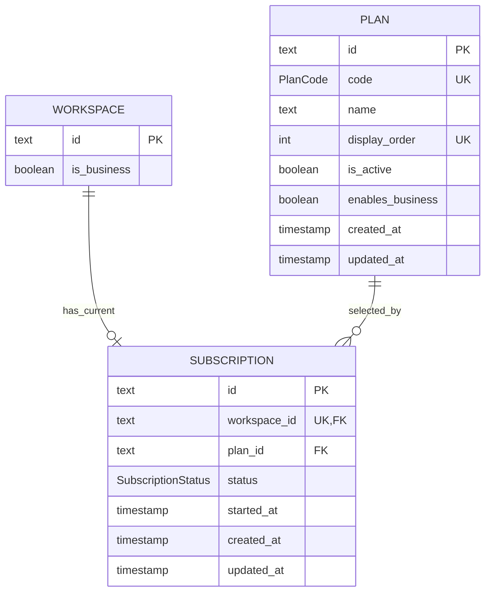

# Data Model: Subscriptions and Plan Entitlements

**Feature**: `019-subscriptions-plans`  
**Date**: 2026-09-16  
**Status**: Design complete

## Model Overview



All new IDs follow the Gateway convention: Prisma `String @id @default(uuid())` represented by TEXT columns in PostgreSQL. Existing workspace IDs are TEXT; do not introduce a UUID-specific database type.

## Entity: Plan

| Field             | Prisma type | Constraints                               | Description                                                |
| ----------------- | ----------- | ----------------------------------------- | ---------------------------------------------------------- |
| `id`              | `String`    | primary key; generated UUID string        | Internal persistence key                                   |
| `code`            | `PlanCode`  | unique; immutable stable request identity | `FREE`, `PLUS`, or `BUSINESS`                              |
| `name`            | `String`    | not null                                  | Presentation name: Free, Plus, Business                    |
| `displayOrder`    | `Int`       | unique; positive                          | Stable catalogue order 1, 2, 3                             |
| `isActive`        | `Boolean`   | defaults true                             | Whether the plan can be selected                           |
| `enablesBusiness` | `Boolean`   | defaults false                            | The only source for the synchronized Workspace entitlement |
| `createdAt`       | `DateTime`  | default now                               | Catalogue audit timestamp                                  |
| `updatedAt`       | `DateTime`  | Prisma-managed                            | Catalogue audit timestamp                                  |

### Fixed canonical rows

| code       | name     | displayOrder | isActive | enablesBusiness |
| ---------- | -------- | -----------: | -------- | --------------- |
| `FREE`     | Free     |            1 | true     | false           |
| `PLUS`     | Plus     |            2 | true     | false           |
| `BUSINESS` | Business |            3 | true     | true            |

The production migration upserts exactly these rows. There is no plan administration endpoint in this feature. The availability field remains explicit so plan selection has a durable validation rule without inventing future pricing behavior.

## Entity: Subscription

| Field         | Prisma type          | Constraints                                       | Description                                                     |
| ------------- | -------------------- | ------------------------------------------------- | --------------------------------------------------------------- |
| `id`          | `String`             | primary key; generated UUID string                | Internal persistence key                                        |
| `workspaceId` | `String`             | unique, non-null FK → Workspace; cascade deletion | Enforces exactly one durable current subscription per workspace |
| `planId`      | `String`             | non-null FK → Plan; restrict deletion             | Selected catalogue plan                                         |
| `status`      | `SubscriptionStatus` | non-null, default `ACTIVE`                        | Lifecycle field for this current-selection model                |
| `startedAt`   | `DateTime`           | default now                                       | Original current-subscription start timestamp                   |
| `createdAt`   | `DateTime`           | default now                                       | Persistence audit timestamp                                     |
| `updatedAt`   | `DateTime`           | Prisma-managed                                    | Last plan selection timestamp                                   |

### Relations and indexes

- `Workspace.subscription?: Subscription` is a one-to-zero-or-one relation. It is optional in generated types solely to permit applying the migration to the pre-backfill state; after deployment and provisioning, the business invariant is exactly one.
- `Plan.subscriptions: Subscription[]` allows a plan to be selected by many workspaces.
- `Subscription.workspaceId @unique` prevents duplicate current records and makes repeated selection idempotent.
- Index `planId` supports inspection/reporting by plan; index `status` supports future operational checks.
- Subscription deletion cascades only when its Workspace is deleted. Plan deletion is restricted while a subscription selects it.

## Enums

```prisma
enum PlanCode {
  FREE
  PLUS
  BUSINESS
}

enum SubscriptionStatus {
  ACTIVE
}
```

`SubscriptionStatus` intentionally has only `ACTIVE` in this feature. Cancellation, expiration, billing delinquency, and subscription history have no requirements; introducing their states would imply flows not delivered here.

## Required Prisma Shape

```prisma
model Workspace {
  // Existing fields ...
  subscription Subscription?
}

model Plan {
  id              String         @id @default(uuid())
  code            PlanCode       @unique
  name            String
  displayOrder    Int            @unique @map("display_order")
  isActive        Boolean        @default(true) @map("is_active")
  enablesBusiness Boolean        @default(false) @map("enables_business")
  subscriptions   Subscription[]
  createdAt       DateTime       @default(now()) @map("created_at")
  updatedAt       DateTime       @updatedAt @map("updated_at")

  @@map("plans")
}

model Subscription {
  id          String             @id @default(uuid())
  workspaceId String             @unique @map("workspace_id")
  workspace   Workspace          @relation(fields: [workspaceId], references: [id], onDelete: Cascade)
  planId      String             @map("plan_id")
  plan        Plan               @relation(fields: [planId], references: [id], onDelete: Restrict)
  status      SubscriptionStatus @default(ACTIVE)
  startedAt   DateTime           @default(now()) @map("started_at")
  createdAt   DateTime           @default(now()) @map("created_at")
  updatedAt   DateTime           @updatedAt @map("updated_at")

  @@index([planId])
  @@index([status])
  @@map("subscriptions")
}
```

## Validation and Invariants

| Rule                                                 | Enforcement point                                                                                    |
| ---------------------------------------------------- | ---------------------------------------------------------------------------------------------------- |
| Catalogue exposes Free, Plus, Business in this order | deterministic migration seed; `findMany({ orderBy: { displayOrder: 'asc' } })`; focused tests        |
| Only a known active plan can be selected             | `PlanCode` DTO enum validation and transaction lookup by `{ code, isActive: true }`                  |
| One current subscription exists per workspace        | `workspaceId @unique`; migration backfill; Free provisioning in both workspace creation transactions |
| Only Business entitles Business capabilities         | plan row `enablesBusiness`; transaction projects it to `Workspace.isBusiness`                        |
| Client cannot assign entitlement                     | remove `isBusiness` from workspace DTOs; global whitelist + `forbidNonWhitelisted` produces 400      |
| Only active owners/admins select                     | global `@WorkspaceRoles(OWNER, ADMIN)` and matching service-level membership predicate               |
| All-or-nothing plan change                           | one interactive Prisma transaction containing Subscription and Workspace updates                     |
| Unsuccessful selection preserves state               | authorization and active-plan checks run before writes; transaction rolls back persistence failure   |

## State Transitions

### Subscription lifecycle

```text
workspace created or migrated
            │
            ▼
        ACTIVE / FREE
            │ owner or admin selects an active plan
            ├──────────────────────────┐
            ▼                          │
   ACTIVE / selected plan ◄────────────┘
```

The record stays `ACTIVE` and its `planId` changes. There is no cancellation/history transition in scope.

### Entitlement projection

| Selected plan | `Subscription.planId`     | `Workspace.isBusiness` |
| ------------- | ------------------------- | ---------------------- |
| Free          | Plan with `code=FREE`     | false                  |
| Plus          | Plan with `code=PLUS`     | false                  |
| Business      | Plan with `code=BUSINESS` | true                   |

The table is updated in the same transaction; the boolean must never be written from an HTTP DTO after this feature.

## Migration and Backfill Rules

The migration must:

1. Create PlanCode and SubscriptionStatus enums, Plans, Subscriptions, unique/index/FK constraints, with a `BEGIN`/ `COMMIT` boundary.
2. Insert/upsert all three canonical plans using fixed values and explicit timestamps.
3. Insert one ACTIVE Subscription per existing Workspace with `started_at`, `created_at`, and `updated_at` set to migration time.
4. Choose Business where `workspaces.is_business=true`; choose Free otherwise.
5. Preserve `workspaces.is_business` during backfill. The resulting Subscription must agree with it by construction.
6. Use conflict-safe handling on workspace ID so a retry cannot create duplicates.

The development seed mirrors these rules: it upserts plans before creating seed workspaces and creates Free subscriptions for personal workspaces plus Business for the existing business fixture.
