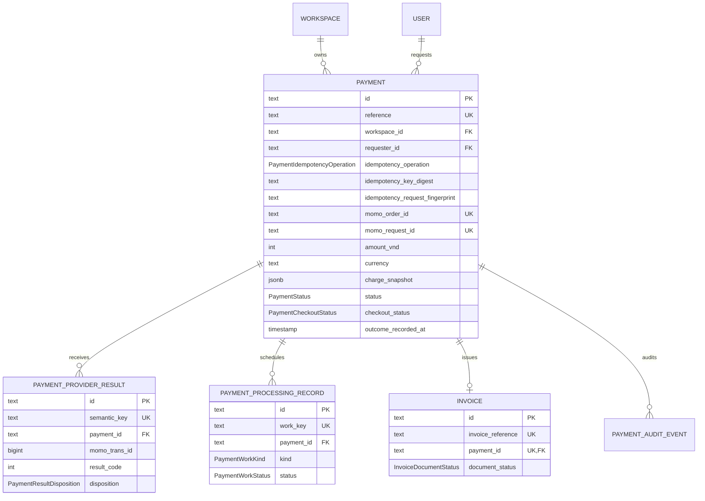

# Data Model: MoMo Payment Module

**Feature**: `020-momo-payment`  
**Date**: 2026-09-18  
**Status**: Design complete

## Model overview



All IDs follow the existing Gateway convention: Prisma `String @id @default(uuid())` stored in PostgreSQL text columns. Monetary values are whole-number `Int` VND, which safely covers the documented one-time-wallet range. No decimal or browser-provided monetary value is accepted.

## Entity: Payment

One durable attempt to collect one server-approved charge through MoMo.

| Field | Prisma type / constraint | Description |
| --- | --- | --- |
| `id` | `String` PK | Internal persistence key |
| `reference` | `String @unique` | Non-PII public payment reference; generated to satisfy MoMo `orderId` syntax |
| `workspaceId` | FK → `Workspace`, indexed | Owning tenant; all read paths bind to this value |
| `requesterId` | FK → `User`, indexed | Authenticated owner/admin that initiated the attempt |
| `idempotencyOperation`, `idempotencyKeyDigest` | composite unique scope | SHA-256 digest of the client key, scoped to requester, workspace, and operation; raw key is never stored |
| `idempotencyRequestFingerprint` | SHA-256 trusted intent | Approved quote, terms, currency, workspace, and operation; detects key reuse with another intent |
| `provider` | `PaymentProvider` default `MOMO` | V1 has only MoMo, but records the provider explicitly |
| `momoOrderId` | `String @unique` | Stable provider transaction/order identity; never reused for another Payment |
| `momoRequestId` | `String @unique` | UUID v4 used for MoMo POST idempotency; never derived from the client key |
| `amountVnd` | `Int` | Immutable approved total in VND |
| `currency` | `String` constrained to `VND` | Immutable currency projection |
| `chargeSnapshot` | `Json` | Immutable item code, display text, quantity, base/tax/total VND, terms version and issuer-relevant data |
| `status` | `PaymentStatus` | Authoritative lifecycle state |
| `checkoutStatus` | `PaymentCheckoutStatus` | Status of the MoMo checkout-initialization process, separate from payment outcome |
| `checkoutUrl` | nullable `String` | Latest provider `payUrl`; never logged, returned only to an authorized initiator or idempotent retry |
| `momoTransactionId` | nullable `BigInt`, indexed | MoMo `transId` after verified processing; serialize as string in HTTP JSON |
| `providerResultCode` | nullable `Int` | Last accepted provider result code |
| `expiresAt` | nullable `DateTime` | Local recovery window, not authority for declaring a payment expired |
| `succeededAt`, `failedAt`, `cancelledAt` | nullable `DateTime` | Terminal timestamps where applicable |
| `outcomeRecordedAt` | nullable `DateTime` | Atomic once-only marker set after a verified terminal result is accepted for local processing |
| `createdAt`, `updatedAt` | timestamps | Persistence audit timestamps |

Required indexes: `reference` unique, `momoOrderId` unique, `momoRequestId` unique, unique `[requesterId, workspaceId, idempotencyOperation, idempotencyKeyDigest]`, `[workspaceId, createdAt]`, `[workspaceId, status, updatedAt]`, and `[status, checkoutStatus, expiresAt]` for recovery scans.

## Entity: PaymentProviderResult

A scrubbed receipt of one inbound MoMo callback/result. It may have no Payment relation when the order is unknown or authenticity fails.

| Field | Constraint | Description |
| --- | --- | --- |
| `id` | PK | Internal identity |
| `semanticKey` | unique SHA-256 | Derived from the normalized signed identity fields; raw signature is excluded |
| `paymentId` | nullable FK → `Payment`, indexed | Set only after safe order/reference lookup |
| `provider`, `partnerCode`, `orderId`, `requestId` | indexed safe identifiers | Correlation data needed for reconciliation |
| `momoTransactionId` | nullable `BigInt`, indexed | Provider transaction correlation, not a blindly trusted key |
| `resultCode`, `claimedOutcome` | mapped values | Claimed provider result; no unverified state implication |
| `disposition` | `PaymentResultDisposition` | `VERIFIED`, `REJECTED`, `DUPLICATE`, or `CONFLICT_IGNORED` |
| `reasonCode` | nullable safe enum/string | E.g. `INVALID_SIGNATURE`, `AMOUNT_MISMATCH`, `FINAL_STATE_CONFLICT` |
| `responseTime`, `receivedAt`, `lastReceivedAt` | timestamps | Provider and receipt timing |
| `duplicateCount` | non-negative integer | Incremented for the exact same semantic callback without creating effects |
| `safePayload` | `Json` | Only mapped non-secret fields necessary for support; excludes raw signature, access key, secrets, and unneeded PII |

The unique semantic key identifies an exact delivery. A changed or contradictory result becomes a new `CONFLICT_IGNORED` record instead of overwriting evidence or state.

## Entity: PaymentProcessingRecord

Durable, lease-claimed work and once-only internal-effect evidence. It fulfils the specification's processing-record entity and avoids in-memory retry state.

| Field | Constraint | Description |
| --- | --- | --- |
| `id` | PK | Internal identity |
| `paymentId` | FK → `Payment`, indexed | Owned payment |
| `workKey` | unique deterministic key | `<paymentReference>:<kind>`; prevents duplicate work creation |
| `kind` | `PaymentWorkKind` | `CREATE_CHECKOUT`, `RECONCILE_MOMO`, `APPLY_SUCCESS`, `APPLY_FAILURE`, `ISSUE_INVOICE`, `RENDER_INVOICE` |
| `status` | `PaymentWorkStatus` | `PENDING`, `LEASED`, `COMPLETED`, `RETRYABLE`, `MANUAL_REVIEW` |
| `attemptCount` | non-negative integer | Retry accounting |
| `availableAt` | indexed timestamp | Earliest next eligible retry |
| `leaseOwner`, `leaseExpiresAt` | nullable, indexed | Atomic worker claim and abandoned-work recovery |
| `lastAttemptAt`, `completedAt` | nullable timestamps | Execution evidence |
| `safeFailureCode` | nullable string | Sanitized, non-secret reason |
| `createdAt`, `updatedAt` | timestamps | Audit timing |

Index `[status, availableAt, leaseExpiresAt]` supports multi-replica workers. A worker claims a batch using a parameterized row-lock query with `FOR UPDATE SKIP LOCKED`, commits the lease, performs I/O, then conditionally completes or retries the same lease.

## Entity: Invoice

One immutable commercial receipt per confirmed successful payment. It is not represented as a government-recognized e-invoice.

| Field | Constraint | Description |
| --- | --- | --- |
| `id` | PK | Internal identity |
| `invoiceReference` | unique immutable human-safe reference | Receipt identity assigned once |
| `paymentId` | unique FK → `Payment` | One invoice maximum for one successful payment |
| `issuedAt` | timestamp | Fixed rendering input |
| `issuerSnapshot`, `payerSnapshot`, `lineItemsSnapshot` | Json | Immutable presentation and item data from approved configuration and Payment snapshot |
| `subtotalVnd`, `taxVnd`, `totalVnd`, `currency` | immutable values | Amount fields shown on the receipt |
| `documentStatus` | `InvoiceDocumentStatus` | `PENDING_RENDER`, `AVAILABLE`, or `RETRYABLE` |
| `storageBucket`, `storageKey`, `contentSha256` | nullable | Private object metadata only; no permanent public URL |
| `createdAt`, `updatedAt` | timestamps | Audit timing |

The render key is deterministic, such as `invoices/<invoiceReference>.pdf`. Retrying an upload can safely replace only the same immutable document. Downloads return a short-lived signed URL after current-workspace authorization.

## Entity: PaymentAuditEvent

An append-only non-sensitive audit trail.

| Field | Description |
| --- | --- |
| `id`, `paymentId`, `invoiceId?` | Event and related durable identities |
| `action` | `PAYMENT_CREATED`, `IDEMPOTENCY_REPLAYED`, `CHECKOUT_READY`, `PROVIDER_RESULT_VERIFIED`, `STATE_CHANGED`, `WORK_RETRIED`, `OUTCOME_RECORDED`, `INVOICE_ISSUED`, `INVOICE_RENDERED`, `RECONCILIATION_COMPLETED`, or safe rejection/conflict action |
| `previousState`, `newState` | Present for state transitions |
| `actorKind` | `USER`, `MOMO`, `SCHEDULER`, or `SYSTEM` |
| `correlationId`, `reasonCode`, `occurredAt` | Operational correlation and safe explanation |

No audit row stores credentials, cookie values, raw HMAC signatures, payment URLs, or arbitrary full request payloads.

## Enums and state transitions

```text
PaymentStatus

PENDING --verified resultCode 0--> SUCCEEDED
PENDING --verified terminal non-success--> FAILED | EXPIRED | CANCELLED | REJECTED
PENDING --verified processing code--> PENDING (schedule reconciliation)
final state --late/conflicting callback--> final state unchanged

PaymentCheckoutStatus

NOT_REQUESTED -> REQUESTING -> READY
                       |          |
                       v          v
                    UNKNOWN   UNKNOWN (then signed query/recovery)
                       |
                       v
                  UNAVAILABLE (safe provider rejection)
```

`PaymentProviderResult.disposition` is deliberately independent of `PaymentStatus`: invalid or mismatched callbacks are retained as `REJECTED` receipts and do not change the Payment.

## Transactional invariants

1. A raw client idempotency key never reaches the database, logs, MoMo, or an API response.
2. Identical client retries return the same Payment and provider checkout projection; fingerprint conflicts return 409 and preserve the original row.
3. The Payment and its idempotency fields commit before provider I/O. Provider I/O never occurs inside an open transaction.
4. Only HMAC-verified, database-matched IPN/query data may conditionally transition a pending Payment.
5. A final Payment cannot regress. Duplicates increment receipt counters; contradictory results remain investigation evidence only.
6. `Payment.outcomeRecordedAt` is conditionally set once alongside `Invoice.paymentId`, `Invoice.invoiceReference`, and each `PaymentProcessingRecord.workKey` to enforce once-only local effects at database level.
7. An invoice render/upload problem may make its document retryable but never changes a successful Payment back to failed.
8. All customer read/update queries include the workspace resolved by the existing workspace-context guard; a reference alone is never authorization.

## Migration and retention rules

The hand-reviewed Prisma migration must create all tables, enums, indexes, and foreign keys in one transaction following the existing Gateway migration conventions. The model-consolidation migration copies each one-to-one idempotency/outcome record into its Payment before removing the child tables. The seed may create only clearly marked local/test payment fixtures and must delete dependent audit/result/work/invoice rows before payments. Financial and idempotency records require a documented retention policy that exceeds MoMo's minimum 31-day provider idempotency window.
